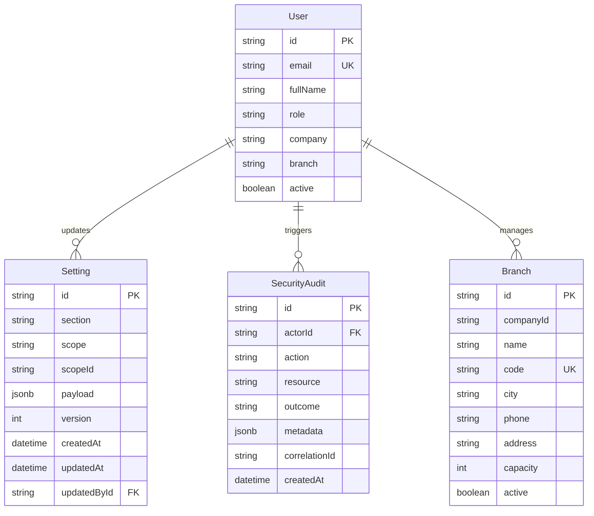

# SYSTEM SETTINGS DATABASE MAPPING & DATA ARCHITECTURE
**Project:** Alpha Health Group WhatsApp CRM  
**Date:** November 03, 2026  

---

## 1. Database Entity-Relationship Diagram

---

## 2. Table Specifications

### 2.1 Table: `Setting`
Stores configuration payloads across all global and company scopes.

| Column | Type | Constraints | Description |
|---|---|---|---|
| `id` | `TEXT` | `PRIMARY KEY` (CUID/UUID) | Unique record identifier. |
| `section` | `TEXT` | `NOT NULL` | Module identifier (e.g. `company`, `sales`, `marketing`). |
| `scope` | `TEXT` | `NOT NULL` | Hierarchy level: `'global'`, `'company'`, or `'user'`. |
| `scopeId` | `TEXT` | `NULLABLE` | Company code (e.g. `'RWC'`, `'CRAS'`) or User ID for user scope. |
| `payload` | `JSONB` | `NOT NULL` | Encrypted/validated configuration payload. |
| `version` | `INTEGER` | `NOT NULL`, `DEFAULT 1` | Monotonically increasing revision counter for OCC. |
| `createdAt` | `TIMESTAMP(3)`| `NOT NULL`, `DEFAULT now()`| Initial creation timestamp. |
| `updatedAt` | `TIMESTAMP(3)`| `NOT NULL` | Timestamp of latest mutation. |
| `updatedById` | `TEXT` | `NULLABLE`, `REFERENCES "User"("id")` | Operator who committed the revision. |

**Indexes & Constraints**:
- `@@unique([section, scope, scopeId])` — Prevents duplicate settings records per scope.
- `@@index([section])` — Accelerates fast retrieval by section.
- `@@index([scope, scopeId])` — Optimized multi-tenant query filter.

### 2.2 Table: `SecurityAudit`
Immutable ledger of security-relevant system operations.

| Column | Type | Constraints | Description |
|---|---|---|---|
| `id` | `TEXT` | `PRIMARY KEY` | Unique audit event identifier. |
| `actorId` | `TEXT` | `NULLABLE` | User ID of the acting operator. |
| `action` | `TEXT` | `NOT NULL` | Action code (e.g. `settings.company.update`, `auth.login`). |
| `resource` | `TEXT` | `NOT NULL` | Target resource identifier (e.g. `company:RWC`). |
| `outcome` | `TEXT` | `NOT NULL` | Event status: `'authorized'`, `'denied'`, `'failed'`. |
| `metadata` | `JSONB` | `NULLABLE` | Sanitized change diff and execution context. |
| `correlationId` | `TEXT` | `NULLABLE` | Distributed trace correlation token. |
| `createdAt` | `TIMESTAMP(3)`| `NOT NULL`, `DEFAULT now()`| Event timestamp. |

**Indexes**:
- `@@index([actorId, createdAt])` — Enables fast operator history inspection.
- `@@index([action, createdAt])` — Speeds up security compliance queries.

---

## 3. Migration Execution

The settings tables were applied using additive, non-destructive SQL migrations:
- `backend/prisma/migrations/20261103_enterprise_system_settings.sql`
- `backend/prisma/migrations/20261103_company_branch_management.sql`

All schema changes preserve existing tables (`User`, `Lead`, `Appointment`, `MarketingContact`) with zero data loss.

